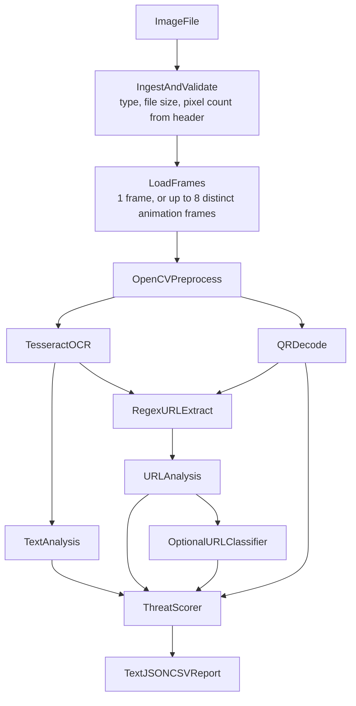

# Architecture

## Pipeline

Batches (`batch`, `evaluate`) send each file to a worker process (`src/core/batch.py`). The parent
enforces a per-file time limit and replaces a worker that hangs or crashes, so the batch always finishes
and keeps the input order.

## Modules

| Path | Role |
|------|------|
| `src/core/pipeline.py` | Orchestrates load → extract → analyze → score; size limits; Inconclusive status |
| `src/core/batch.py` | Worker processes with per-file timeouts and crash isolation |
| `src/core/config.py` | Paths, cached JSON / list loaders, score bands, allowlist |
| `src/extraction/preprocess.py` | Header check, Unicode-safe loading, animation frames, denoise, CLAHE, threshold, deskew, warp |
| `src/extraction/ocr.py` | Multi-variant Tesseract OCR (one run per variant, time-limited) |
| `src/extraction/qr.py` | OpenCV QR (classic + ArUco detector) and optional pyzbar |
| `src/extraction/urls.py` | OCR-tolerant URL isolation |
| `src/analysis/url_analysis.py` | Heuristic URL scoring + features (rule descriptions in `RULES`) |
| `src/analysis/domains.py` | Registrable domain (Public Suffix List) and IP-host helpers |
| `src/analysis/text_analysis.py` | Lexicon / linguistic cues |
| `src/classification/scorer.py` | QR rules, component combination, verdict labels |
| `src/model/classifier.py` | Hostname char n-gram TF-IDF + logistic regression (raise-only), checksum and version checks |
| `src/model/download_data.py` | Fetch PhiUSIIL, Tranco top domains, OpenPhish feed, Public Suffix List |
| `src/model/evaluate_realworld.py` | Detection / false-alarm rates on live data, threshold sweep |
| `src/reporting/report.py` | Human text, JSON, CSV / JSONL batch summary |
| `src/reporting/redact.py` | Masking of phone numbers, OTPs, e-mail / UPI ids, Wi-Fi passwords |
| `src/cli.py` | `analyze`, `batch`, `evaluate`; exit codes |

## Scoring policy

- Components are 0–100. Each rule adds the points listed in `data/config/scoring.json`
  (`url_rules`, `text_rules`, `qr_rules`).
- Final score = max(weighted blend, strongest component). With the default weights (URL 0.45, text 0.35,
  QR 0.20 with a QR code; URL 0.60, text 0.40 without) the blend never exceeds the strongest component, so
  **the strongest component decides**: one malicious link or QR is never diluted by harmless text.
- Bands: Safe ≤ 34, Suspicious 35–69 (more precisely: above 34 and up to 69), High-Risk Phishing above 69.
  Every internal threshold uses the same bands (`score_band` in `src/core/config.py`).
- Multiple URLs: **worst URL wins**. Each URL is analysed once per image, even when it appears in both the
  text and a QR code.
- The QR component scores only URLs decoded from the QR itself, never URLs found in OCR text.
- ML may only **increase** a URL score. Not applied to Tranco top-30k domains or to a hosting platform's own homepage.
- ML alone: p ≥ 0.95 → at least Suspicious (40). With another rule agreeing: p ≥ 0.70 → 40, p ≥ 0.90 → 70.
- Blocklist match (exact URL, or host when not a trusted or allowlisted domain) → +100.
- Allowlisted domains (`data/config/allowlist.txt`) are treated like official brand domains.
- Redirect parameters (`?url=`, `?q=`, `?redirect=` …) are followed offline, also when percent-encoded several
  times (at most 5 targets per URL): a risky target lifts the score to the target's score.
- User-made pages on trusted platforms (Google Sites / Forms, Microsoft Forms, cloud storage such as S3 or Azure
  Blob) → +20, +20 more with brand or login words. Host entries also match their subdomains
  (`bucket.s3.amazonaws.com`).
- Free hosting and dynamic-DNS platforms (`hosting_platforms.json`) → +15 for pages on their subdomains; the
  platform's own homepage is not penalised.
- Brand impersonation: a brand name as a whole hostname token is `brand_name_in_domain`; one edit (or an OCR
  digit swap) away is `typosquat_distance_1`. Brand names of 5 letters or fewer count only at the start of a
  hostname token, so "purchase" (chase) or "pineapple" (apple) are not impersonation. Popular sites (Tranco
  top list), e.g. a brand's own country domains such as `yahoo.co.jp`, are not checked for brand look-alikes.
- A brand chain (`paypal.com.evil.example`) is only detected in the subdomain part, never in the registrable
  domain itself (`paypal.co.uk` is not a chain).
- Internationalised names: mixed scripts are judged per label and only for scripts with Latin look-alike
  letters (Cyrillic, Greek, Armenian, Cherokee, fullwidth), so Thai, Hindi or accented names are not flagged;
  the `xn--` prefix does not count as hyphens.
- Hostnames longer than DNS allows (253 characters, or a label over 63) → 40, without running the
  look-alike search (keeps attacker-sized QR payloads from stalling a scan).
- Malformed URLs that cannot be parsed → 40 (evasion trick); they never crash the scan.
- Registrable domains come from the Public Suffix List (ICANN section), e.g. `x.gov.in`, `a.b.co.uk`.
- Status labels: unreadable, unsupported or oversized files, timeouts and crashed workers → **Error**; nothing
  readable, a QR code that could not be decoded, or text that could not be read because OCR is unavailable →
  **Inconclusive** (unless other evidence already scores Suspicious or higher). Never silently Safe.
